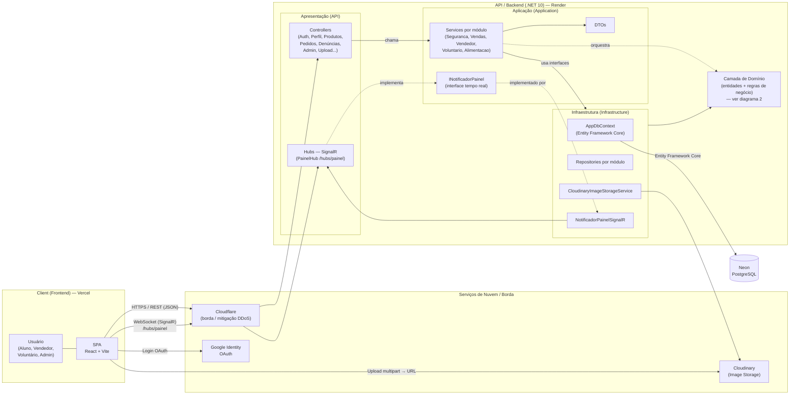
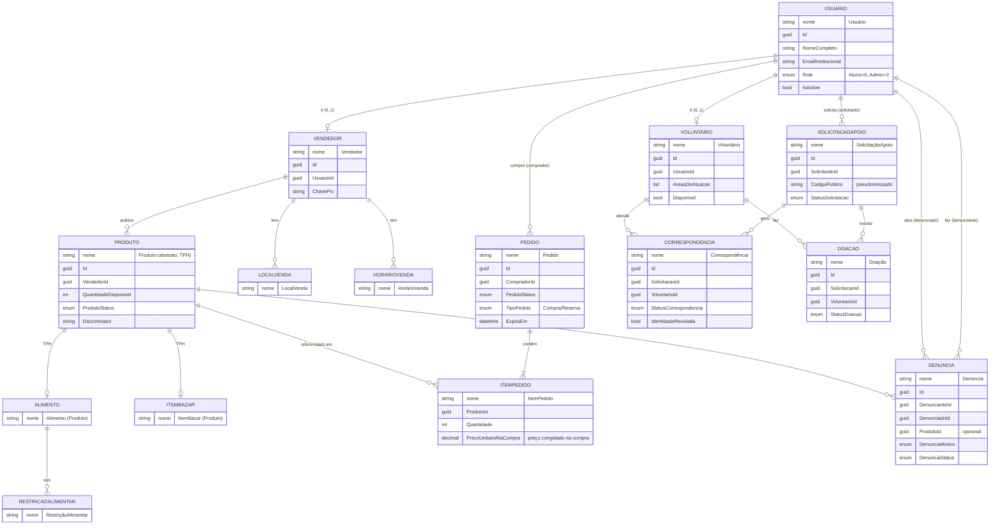

# Diagramas arquiteturais (Mermaid) — UniHub

> Fonte de verdade para regenerar os diagramas. Cole cada bloco em [https\://mermaid.live](https://mermaid.live) (ou no draw.io / Markdown do GitHub) e exporte como PNG. Atualizado para o estado final: módulo Moderação, tempo real (SignalR), hardening de segurança, deploy Vercel \+ Cloudflare.

---

## 1\. Diagrama de arquitetura (camadas e componentes)

&nbsp;

---

## 2. Diagrama de domínio (entidades e relacionamentos)

> Entidades e relacionamentos do núcleo do domínio. Identificadores em MAIÚSCULAS
> (estilo ER); o nome legível de cada entidade aparece na primeira linha da caixa.

